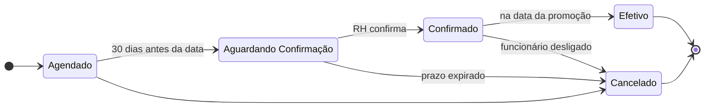

<div align="center">

# Sistema RH

**Sistema web de gestão de Departamento Pessoal: funcionários, férias pela CLT, plano de carreira, treinamentos, ocorrências e documentos em PDF em um só lugar.**

[](https://github.com/ricardoaufe/ProjetoRH/actions/workflows/tests.yml)


[](https://docs.astral.sh/ruff/)


[Sobre](#-sobre-o-projeto) •
[Funcionalidades](#-funcionalidades) •
[Regras de negócio](#-regras-de-negócio) •
[Tecnologias](#-tecnologias) •
[Como rodar](#-como-rodar-localmente) •
[Testes](#-testes-e-qualidade) •
[Deploy](#-deploy) •
[Contato](#-autor)

</div>

---

## 📋 Índice

- [Sobre o projeto](#-sobre-o-projeto)
- [Tour pelo sistema](#-tour-pelo-sistema)
- [Funcionalidades](#-funcionalidades)
- [Regras de negócio](#-regras-de-negócio)
  - [Férias (CLT)](#férias-clt)
  - [Plano de Carreira](#plano-de-carreira)
  - [Avisos automáticos por e-mail](#avisos-automáticos-por-e-mail)
- [Tecnologias](#-tecnologias)
- [Arquitetura e estrutura de pastas](#-arquitetura-e-estrutura-de-pastas)
- [Como rodar localmente](#-como-rodar-localmente)
- [Variáveis de ambiente](#-variáveis-de-ambiente)
- [Comandos de gerenciamento](#-comandos-de-gerenciamento)
- [Testes e qualidade](#-testes-e-qualidade)
- [Deploy](#-deploy)
- [Aprendizados e desafios](#-aprendizados-e-desafios)
- [Autor](#-autor)

---

## 💻 Sobre o projeto

O **Sistema RH** nasceu para substituir as planilhas manuais de um setor de Recursos Humanos real. Ele centraliza o cadastro dos colaboradores e automatiza as tarefas repetitivas do Departamento Pessoal: controlar o saldo e o vencimento de férias, agendar promoções, registrar treinamentos e ocorrências, emitir documentos e avisar a equipe por e-mail antes de cada prazo importante.

O sistema está **em uso em produção** e foi desenvolvido do zero por um estudante de Ciência da Computação, cobrindo todo o ciclo: modelagem de dados, regras de negócio da legislação trabalhista (CLT), interface, testes automatizados, integração contínua e deploy em nuvem.

**Destaques**

- ⚖️ **Férias validadas pela CLT**: períodos aquisitivo e concessivo, fracionamento, abono pecuniário, férias em dobro e bloqueio de início antes de domingo ou feriado.
- 📄 **16 documentos em PDF** gerados com um clique (ficha cadastral, termos, listas e relatórios).
- 📬 **Avisos automáticos por e-mail** para férias a vencer, início de férias, aniversários, fim de contrato e promoções.
- 🔐 **Perfis de acesso granulares**: cada perfil libera ver, criar, editar e excluir por módulo.
- ✅ **Testes automatizados e CI** com lint, checagem de migrations e suíte de testes a cada push.

---

## 📸 Tour pelo sistema

### Dashboard
Painel com métricas rápidas (funcionários ativos, férias em andamento, próximos eventos) e atalhos para as principais funções.

<div align="center">
  
</div>

### Gestão de colaboradores
Listagem com filtros (ativos e demitidos), busca, paginação e indicadores visuais como afastamento e cargo na CIPA.

<div align="center">
  
</div>

### Cadastro completo e validado
Formulário dividido em seções (dados pessoais, contratuais, bancários e dependentes), com máscaras, validação de CPF e regras de negócio integradas.

<div align="center">
  
</div>

### Documentação automática em PDF
Um clique gera a ficha cadastral e os demais documentos do colaborador. O layout usa CSS de mídia paginada (Paged Media), pensado para impressão.

<div align="center">
  
</div>

---

## ✨ Funcionalidades

| Módulo | O que faz |
| :--- | :--- |
| **Dashboard** | Indicadores de funcionários ativos e férias em andamento, gráficos e a agenda de **Próximos Eventos** (aniversários, férias, fim de experiência, fim de contrato, treinamentos e promoções), com filtros por período e setor. |
| **Funcionários** | Cadastro completo com dependentes, jornada de trabalho, dados bancários e contratuais. Histórico do colaborador (promoções, aumentos, mudanças de cargo e de CIPA) gravado a cada alteração. Admissão, desligamento e contratos com prazo determinado. |
| **Férias** | Lançamento com validação das regras da CLT, saldo por período aquisitivo, férias agendadas, abono pecuniário e cálculo automático da data de retorno (pulando fins de semana e feriados). |
| **Ocorrências** | Advertências, atestados e afastamentos por funcionário, com busca de **CID-10**. Afastamentos em andamento marcam o colaborador como "Afastado(a)". |
| **Plano de Carreira** | Promoções agendadas com fluxo de status, confirmação pelo RH e efetivação automática do novo cargo e salário na data prevista. |
| **Treinamentos** | Treinamentos comuns, fundamentais (aplicados a um setor inteiro ou à empresa toda) e de integração (onboarding), com controle de presença e carga horária. |
| **Setores e Cargos** | Estrutura organizacional com salário base por cargo. |
| **Documentos em PDF** | Ficha cadastral, termos de confidencialidade, compromisso, responsabilidade, uso de imagem e consentimento de dados (LGPD), apresentação bancária, aquisição de benefícios, regulamento interno, plano de carreira e listas de funcionários, férias, treinamentos, ocorrências e setores. |
| **Usuários e Perfis** | Perfis de acesso com matriz de permissões (ver / criar / editar / excluir) por módulo, e escolha de quais avisos por e-mail cada usuário recebe. |
| **Automações** | Rotina diária que envia os avisos por e-mail e movimenta os planos de carreira. |

Os campos de seleção de funcionário usam **busca por nome com autocompletar** (Tom Select), tanto para um único funcionário (Férias, Plano de Carreira) quanto para vários (Treinamentos).

> 📘 Existe também um guia de uso para o usuário final (Instrução de Trabalho), com o passo a passo de cada tela. Este README é voltado para quem vai **rodar e desenvolver** o sistema.

---

## ⚖️ Regras de negócio

As regras ficam concentradas em [`rhcontrol/services.py`](rhcontrol/services.py), separadas das views, o que facilita testá-las de forma isolada.

### Férias (CLT)

O sistema calcula os períodos de cada funcionário a partir da **data de admissão** (obrigatória para lançar férias) e confere as regras abaixo antes de salvar. Quando algo não é permitido, a tela explica em uma linha o motivo e o artigo da CLT.

| Regra | Como o sistema aplica | Base legal |
| :--- | :--- | :--- |
| Período aquisitivo | A cada 12 meses de trabalho o funcionário adquire **30 dias** de férias. | Art. 130 |
| Período concessivo | As férias de um período devem ser concedidas nos **12 meses seguintes**. O prazo vence na véspera do aniversário de admissão. | Art. 134 |
| Fracionamento | Até **3 partes**: uma com pelo menos **14 dias** e as demais com pelo menos **5 dias**. | Art. 134 §1º |
| Início das férias | Não podem começar nos **2 dias que antecedem domingo ou feriado** nacional. | Art. 134 §3º |
| Abono pecuniário | Venda do saldo restante do período, de **1 a 10 dias** (até 1/3). | Art. 143 |
| Férias em dobro | Dias não iniciados até o fim do período concessivo aparecem como vencidos (pagos em dobro). | Art. 137 |
| Proporcional | O período em andamento mostra os dias já adquiridos (2,5 por mês). Apenas informativo. | Art. 146 |

Outros detalhes de implementação:

- O **saldo** só é descontado quando as férias **começam**; férias futuras aparecem como "agendado".
- Cada lançamento abate do **período mais antigo** que ainda tem dias, como o RH faz na prática.
- Não há sobreposição de férias, e funcionários desligados só podem ter férias que terminem antes do desligamento.
- O controle começa no período aquisitivo iniciado em **fevereiro de 2025**: períodos anteriores são considerados quitados, pois foram tratados antes do sistema.

### Plano de Carreira



- **30 dias antes** da data da promoção, o plano passa a **Aguardando Confirmação** e um e-mail pede a confirmação do RH.
- Depois de confirmado, a rotina diária **efetiva** o novo cargo e salário na data prevista e registra a mudança no histórico do colaborador.
- Planos não confirmados a tempo, ou de funcionários desligados, são **cancelados automaticamente**. Planos confirmados, efetivados ou cancelados ficam bloqueados para edição.

### Avisos automáticos por e-mail

A rotina diária `run_automations` verifica a agenda e envia e-mails para os destinatários inscritos em cada tipo de aviso:

| Aviso | Quando é enviado |
| :--- | :--- |
| Aniversário do Colaborador / Aniversário de Empresa | Alguns dias antes da data |
| Início de Férias | Alguns dias antes do início |
| **Férias a Vencer** | **4 meses antes** do fim do período concessivo, se ainda faltar lançar dias do período |
| Fim de Contrato | Antes do fim de contratos com prazo determinado (aprendizes e estagiários) |
| Aviso de Promoção | 30 dias antes da data de um plano de carreira |
| Promoção Efetivada / Plano de Carreira Cancelado | No dia em que acontece |

A antecedência de cada aviso é configurada em **Regras de notificação** no Django Admin (`/admin/`). Cada usuário escolhe quais avisos quer receber no próprio cadastro de usuário (é preciso ter e-mail cadastrado). Todo envio fica registrado em um log, o que evita e-mails duplicados.

---

## 🛠 Tecnologias

| Camada | Tecnologias |
| :--- | :--- |
| **Back-end** | Python 3.11, Django 5.2 |
| **Banco de dados** | SQLite (desenvolvimento) · PostgreSQL (produção) |
| **Relatórios** | WeasyPrint (HTML/CSS → PDF), templates do Django |
| **Front-end** | HTML5, CSS3 (padrão BEM), JavaScript, Chart.js, Tom Select, Select2, IMask, Font Awesome |
| **Regras de datas** | `holidays` (feriados nacionais), `python-dateutil` |
| **Qualidade** | pytest, pytest-django, Ruff, GitHub Actions |
| **Infraestrutura** | Google Cloud Platform (VM Linux), Nginx, Gunicorn, cron |

---

## 🗂 Arquitetura e estrutura de pastas

O projeto segue a estrutura padrão do Django, com um projeto de configuração (`rh/`) e um app principal (`rhcontrol/`). Models, views e forms são divididos **por domínio** (um arquivo por módulo), e as regras de negócio ficam na camada de serviços.

```text
ProjetoRH/
├── rh/                         # Configuração do projeto Django
│   ├── settings.py             # Configurações lidas das variáveis de ambiente (.env)
│   └── urls.py
├── rhcontrol/                  # App principal
│   ├── models/                 # Um arquivo por domínio (employee, vacation, career, ...)
│   ├── views/                  # Views por módulo + pdf.py (geração dos documentos)
│   ├── forms/                  # Formulários, validadores e campos reutilizáveis
│   ├── services.py             # Regras de negócio: férias CLT, avisos, plano de carreira, eventos
│   ├── utils.py                # Matriz de permissões dos perfis de acesso
│   ├── filters.py              # Filtros das listagens
│   ├── pagination.py           # Paginação padrão das listas
│   ├── context_processors.py   # Dados da empresa disponíveis em todos os templates
│   ├── management/commands/    # Comandos: run_automations, load_cids, generate_data
│   ├── templates/              # Telas, parciais e templates dos PDFs
│   ├── migrations/
│   └── tests*.py               # Suíte de testes (pytest)
├── base_static/global/         # CSS (components.css + css/pages/*) e JS globais
├── base_templates/global/      # Template base
├── assets/                     # Imagens usadas neste README
├── .env-example                # Modelo das variáveis de ambiente
├── requirements.txt            # Dependências com versões fixadas
├── ruff.toml                   # Regras de lint
└── pytest.ini
```

---

## 🚀 Como rodar localmente

### Pré-requisitos

- **Python 3.11** ou superior
- **Git**
- Bibliotecas de sistema do **WeasyPrint** (necessárias para gerar os PDFs):
  - **Linux (Debian/Ubuntu):** `sudo apt install libpango-1.0-0 libpangoft2-1.0-0`
  - **Windows e macOS:** siga o [guia de instalação do WeasyPrint](https://doc.courtbouillon.org/weasyprint/stable/first_steps.html)

### Passo a passo

```bash
# 1. Clone o repositório
git clone https://github.com/ricardoaufe/ProjetoRH.git
cd ProjetoRH

# 2. Crie e ative um ambiente virtual
python -m venv .venv
# Windows:      .venv\Scripts\activate
# Linux/macOS:  source .venv/bin/activate

# 3. Instale as dependências
pip install -r requirements.txt

# 4. Crie o arquivo de configuração a partir do modelo
cp .env-example .env          # Windows: copy .env-example .env
```

Abra o `.env` e ajuste pelo menos estes valores para desenvolvimento:

```ini
SECRET_KEY = 'cole-aqui-uma-chave-gerada'
DEBUG = 1
EMAIL_BACKEND = 'django.core.mail.backends.console.EmailBackend'
```

> 💡 Para gerar a `SECRET_KEY`:
> `python -c "from django.core.management.utils import get_random_secret_key; print(get_random_secret_key())"`
>
> Com o `EMAIL_BACKEND` de console, os e-mails de aviso são impressos no terminal em vez de enviados.

```bash
# 5. Crie as tabelas do banco (SQLite por padrão)
python manage.py migrate

# 6. Crie um usuário administrador
python manage.py createsuperuser

# 7. (Opcional) Carregue a tabela CID-10 usada nas ocorrências
python manage.py load_cids

# 8. Inicie o servidor
python manage.py runserver
```

Acesse **http://127.0.0.1:8000** e entre com o usuário criado no passo 6. O painel administrativo do Django fica em **http://127.0.0.1:8000/admin/**.

### Usando PostgreSQL

Instale o driver (`pip install "psycopg[binary]"`) e troque no `.env`:

```ini
DATABASE_ENGINE = 'django.db.backends.postgresql'
DATABASE_NAME = 'nome_do_banco'
DATABASE_USER = 'usuario'
DATABASE_PASSWORD = 'senha'
DATABASE_HOST = '127.0.0.1'
DATABASE_PORT = '5432'
```

---

## 🔧 Variáveis de ambiente

Todas são lidas por [`rh/settings.py`](rh/settings.py). O modelo completo, com comentários, está em [`.env-example`](.env-example).

| Variável | Descrição | Padrão |
| :--- | :--- | :--- |
| `SECRET_KEY` | Chave secreta do Django. **Obrigatória**; nunca publique a de produção. | — |
| `DEBUG` | `1` liga o modo de depuração (só em desenvolvimento). | `0` |
| `ALLOWED_HOSTS` | Domínios/IPs aceitos, separados por vírgula. | `localhost,127.0.0.1` |
| `CSRF_TRUSTED_ORIGINS` | Origens confiáveis para o CSRF, com `http://` ou `https://`. | `http://127.0.0.1` |
| `USE_HTTPS` | `1` ativa cookies seguros, redirecionamento para HTTPS e HSTS. | `0` |
| `BEHIND_HTTPS_PROXY` | `1` quando um proxy (Nginx) termina o HTTPS e repassa `X-Forwarded-Proto`. | `0` |
| `SECURE_HSTS_SECONDS` | Duração do HSTS (só com `USE_HTTPS=1`). | `31536000` |
| `LOG_LEVEL` | Nível de log do app `rhcontrol`. | `DEBUG` se `DEBUG=1`, senão `INFO` |
| `DATABASE_ENGINE`, `DATABASE_NAME`, `DATABASE_USER`, `DATABASE_PASSWORD`, `DATABASE_HOST`, `DATABASE_PORT` | Conexão com o banco de dados. | — |
| `EMAIL_BACKEND`, `EMAIL_HOST`, `EMAIL_PORT`, `EMAIL_USE_TLS`, `EMAIL_HOST_USER`, `EMAIL_HOST_PASSWORD`, `DEFAULT_FROM_EMAIL` | Envio dos avisos por e-mail. | SMTP em `localhost:25` |
| `COMPANY_NAME`, `COMPANY_CNPJ`, `COMPANY_ADDRESS`, ... | Dados da empresa exibidos nas telas e nos PDFs. | Valores genéricos de demonstração |

> 🔒 O repositório usa apenas **dados genéricos de demonstração**. Os dados reais da empresa ficam somente no `.env` do servidor de produção, nunca no código.

---

## ⚙️ Comandos de gerenciamento

| Comando | Para que serve |
| :--- | :--- |
| `python manage.py run_automations` | Executa as rotinas diárias: avisos por e-mail e transições do plano de carreira. |
| `python manage.py run_automations --only notifications` | Executa só uma rotina (`notifications` ou `career_plans`). |
| `python manage.py run_automations --dry-run` | Simula a execução: mostra o que seria feito sem gravar no banco nem enviar e-mails. |
| `python manage.py load_cids` | Baixa e importa a tabela CID-10 (precisa de internet). |
| `python manage.py generate_data 50` | Cria setores, cargos e 50 funcionários fictícios para testes. Requer `pip install faker`. |

Em produção, `run_automations` deve rodar **uma vez por dia**, por exemplo via cron:

```cron
# Todos os dias às 06:00
0 6 * * * cd /caminho/do/ProjetoRH && .venv/bin/python manage.py run_automations
```

---

## 🧪 Testes e qualidade

```bash
# Roda toda a suíte de testes
pytest

# Lint: aponta imports sem uso, except genérico e armadilhas comuns
ruff check .
ruff check . --fix   # corrige automaticamente o que for seguro
```

> ⚠️ **No Windows**, rode os testes com o modo UTF-8 do Python ativado, senão a leitura de arquivos com acentos pode falhar:
>
> ```powershell
> $env:PYTHONUTF8=1; pytest          # PowerShell
> ```
> ```bat
> set "PYTHONUTF8=1" && pytest       :: Prompt de Comando
> ```

A suíte cobre as regras de férias da CLT, avisos de férias a vencer, segurança (permissões e acesso), seleção de funcionários, templates (por exemplo, proíbe estilos inline) e desempenho de consultas, entre outros.

### Integração contínua

A cada push na `main` e em todo Pull Request, o GitHub Actions ([`.github/workflows/tests.yml`](.github/workflows/tests.yml)) executa:

1. `ruff check .` (lint)
2. `python manage.py check` (checagens do Django)
3. `python manage.py makemigrations --check --dry-run` (falha se um model mudou sem a migration correspondente)
4. `pytest` (suíte de testes)

---

## 🌐 Deploy

Em produção, o sistema roda em uma VM Linux no Google Cloud, com **Gunicorn** servindo a aplicação e **Nginx** como proxy reverso (HTTPS e arquivos estáticos).

Checklist para publicar uma nova versão:

```bash
git pull
pip install -r requirements.txt          # só se o requirements.txt mudou
python manage.py migrate                 # só se houver migrations novas
python manage.py collectstatic --noinput # só se CSS/JS/imagens mudaram
sudo systemctl restart gunicorn          # sempre (ajuste ao nome do seu serviço)
```

| O que mudou | O que rodar |
| :--- | :--- |
| Código Python ou templates | Reiniciar o Gunicorn |
| Arquivos em `base_static/` (CSS, JS, imagens) | `collectstatic --noinput` + reiniciar o Gunicorn |
| Models (nova pasta em `migrations/`) | `migrate` + reiniciar o Gunicorn |
| `requirements.txt` | `pip install -r requirements.txt` + reiniciar o Gunicorn |

> Use `collectstatic --noinput` **sem** `--clear`, para não apagar arquivos estáticos que existam apenas no servidor.

Configurações recomendadas no `.env` de produção: `DEBUG=0`, `USE_HTTPS=1`, `BEHIND_HTTPS_PROXY=1`, `ALLOWED_HOSTS` e `CSRF_TRUSTED_ORIGINS` com o domínio real, e um servidor SMTP de verdade em `EMAIL_*`.

---

## 💡 Aprendizados e desafios

- **Regras trabalhistas em código:** transformar os artigos da CLT sobre férias em regras testáveis, com mensagens claras para quem usa o sistema, foi o maior desafio de modelagem.
- **Geração de PDF:** configurar o WeasyPrint para renderizar HTML/CSS com precisão para impressão, criando documentos oficiais, e otimizar a leitura dos arquivos estáticos direto do disco.
- **Deploy em nuvem:** configurar do zero um servidor Linux no Google Cloud com Gunicorn, Nginx, HTTPS e tarefas agendadas.
- **Qualidade de código:** introduzir testes automatizados, lint e CI em um projeto já em uso, sem quebrar o que estava em produção.
- **Segurança:** perfis de acesso por módulo, validação das permissões no servidor e configurações seguras de cookies e HTTPS.

---

## 👤 Autor

**Ricardo Augusto Sousa Ferreira**

[](https://www.linkedin.com/in/ricardo-ferreira-8b5145371)
[](mailto:rasf0831@gmail.com)
[](https://github.com/ricardoaufe)
